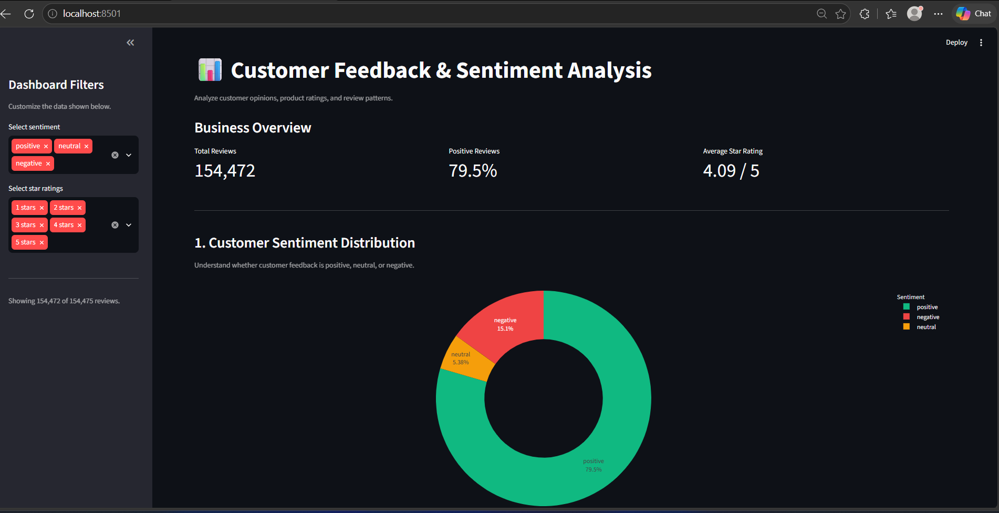
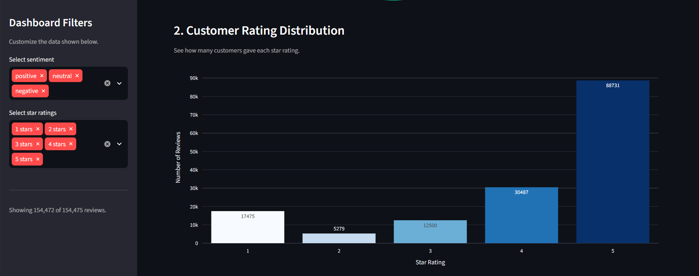

## Customer Feedback & Sentiment Analysis

An interactive data analytics project that analyzes customer reviews and product ratings to understand customer sentiment and identify patterns in feedback.

## Overview

Customer reviews provide valuable insights into customer satisfaction. This project uses Python to clean and analyze Flipkart product review data and presents the findings through an interactive Streamlit dashboard.

## Objectives

- Analyze positive, negative, and neutral customer reviews.
- Understand the relationship between product ratings and sentiment.
- Explore review length across sentiment categories.
- Present insights through interactive visualizations.
- Demonstrate data cleaning, exploratory data analysis, and dashboard development.

## Technologies Used

- **Python** — core programming language
- **Pandas** — data cleaning and manipulation
- **Plotly** — interactive charts and visualizations
- **Streamlit** — interactive web dashboard
- **CSV** — dataset storage

## Features

- Interactive sentiment distribution chart
- Product rating distribution analysis
- Rating versus sentiment comparison
- Average review length by sentiment
- Sidebar filters for ratings and sentiment
- Key metrics and summary insights

## Project Structure

```text
customer-feedback-sentiment-analysis/
├── app.py
├── clean_data.py
├── requirements.txt
├── .gitignore
├── README.md
├── data/
├── screenshots/
└── docs/
```

## Dataset

The project uses the Flipkart Product Reviews with Sentiment dataset available on Kaggle.

Dataset source: https://www.kaggle.com/dsv/4940809

The dataset contains product names, prices, ratings, review text, review summaries, and sentiment labels.

Please obtain the dataset from its source and follow its applicable license and sharing terms.

## Data Cleaning

The data preprocessing script performs the following operations:

- Checks missing values and duplicate records
- Standardizes text and sentiment labels
- Converts product ratings to numeric values
- Removes records with missing review text or sentiment
- Retains valid sentiment categories
- Removes exact duplicate records
- Calculates review length
- Exports the cleaned dataset for analysis

## Installation and Usage

### 1. Clone the repository

```bash
git clone https://github.com/sahasrabudhemedhal-boop/customer-feedback-sentiment-analysis.git
cd customer-feedback-sentiment-analysis
```

### 2. Install dependencies

bash
python -m pip install -r requirements.txt


### 3. Prepare the dataset

Place the permitted source CSV file in the project folder using the filename expected by `clean_data.py`.

Run:

```bash
python clean_data.py
```

This generates `cleaned_reviews.csv`.

### 4. Launch the dashboard

```bash
python -m streamlit run app.py
```

Open the local URL displayed in the terminal.

## Key Findings

The analysis explores sentiment distribution, customer ratings, and differences in review length.

The original dataset contains a larger proportion of positive reviews than negative or neutral reviews. Higher product ratings are generally associated with positive sentiment, while lower ratings are more frequently associated with negative sentiment.

See the dashboard for detailed visualizations and the results obtained after preprocessing.
## Dashboard Preview





## Limitations

- The analysis depends on the sentiment labels provided with the dataset.
- The dataset may not represent all Flipkart customers or products.
- Sentiment labels may contain classification errors.
- The project analyzes review data rather than actual sales or customer purchase histories.

## Future Enhancements

- Apply Natural Language Processing (NLP) techniques.
- Build a sentiment prediction model.
- Compare machine learning models using suitable evaluation metrics.
- Add product-level sentiment comparisons.
- Deploy the dashboard online.

## Author

Medhal Sahasrabudhe

MCA Student | Data Analytics and Python Projects
